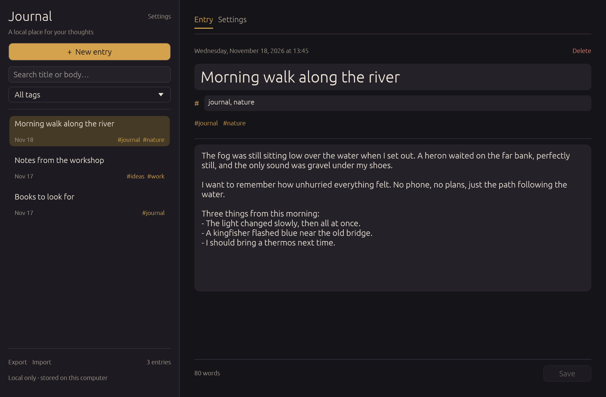
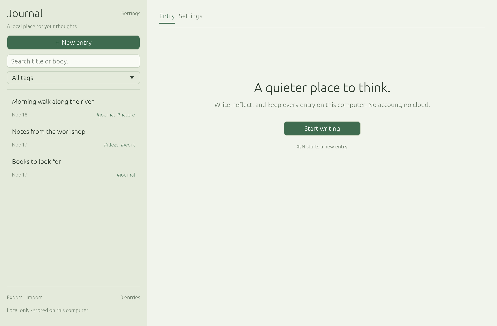
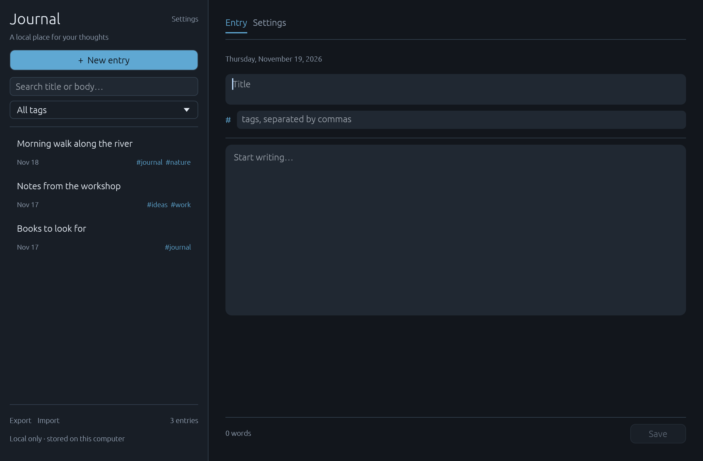

# Journal

**A quiet, local-first journal for the desktop.**

[](LICENSE)


Journal is a private, single-user desktop journal built in Rust with
[egui](https://github.com/emilk/egui) and SQLite. It opens like a notebook:
your entries on the left, a calm writing surface on the right. No account, no
cloud, and no background synchronization.


## Highlights

- **Focused two-pane layout** — browse, search, and write without leaving the window.
- **Four themes** — Warm, Dark, Slate, and Forest, with a persistent choice.
- **Comfortable settings** — text size, startup behavior, backup controls, and an About panel.
- **Local SQLite storage** — versioned schema, parameterized SQL, and transactional writes.
- **Search and tags** — search titles and body text, then narrow the list by tag.
- **Safe editing** — unsaved-change prompts when switching entries or closing the window.
- **Confirmed deletes** — destructive actions require an explicit confirmation.
- **JSON backup and restore** — validated before import and applied in a single transaction.
- **Visible failures** — save, database, and backup errors are reported in the UI instead of being swallowed.

## Screenshots

| Warm theme | Dark theme |
| --- | --- |
|  |  |

| Settings and About | Forest welcome screen |
| --- | --- |
|  |  |

| New entry in the Slate theme |
| --- |
|  |

The screenshots were captured from the running desktop application.

## Platform support

Journal is a native cross-platform application. The same Rust codebase runs on:

- **macOS**
- **Windows**
- **Linux**

**Verification:** this release was built, tested, and manually exercised on
macOS (Apple Silicon) with Rust stable. The screenshots above were captured
from the running macOS build. Windows and Linux are supported targets through
the same `eframe`/`egui` and bundled-SQLite stack.

### Prerequisites

- A current stable Rust toolchain (`rustup` recommended).
- macOS: Xcode Command Line Tools.
- Windows: the MSVC Rust toolchain and Visual Studio C++ build tools.
- Linux: a working X11 or Wayland session, a GPU driver, and the usual
  windowing development packages (for Debian/Ubuntu: `build-essential`,
  `pkg-config`, `libxkbcommon-dev`, `libwayland-dev`, `libx11-dev`, and
  `libxcb1-dev`).

## Build and run

From the repository root:

```sh
cargo run --release
```

For a debug build:

```sh
cargo build
./target/debug/journal-app
```

The application creates its database automatically on first launch.

## Where your journal lives

Journal stores its SQLite database in the operating system's per-user
application data directory:

| Platform | Database path |
| --- | --- |
| macOS | `~/Library/Application Support/com.JournalApp.Journal/journal.sqlite3` |
| Windows | `%APPDATA%\JournalApp\Journal\data\journal.sqlite3` |
| Linux | `${XDG_DATA_HOME:-~/.local/share}/journal/journal.sqlite3` |

The exact path is shown in **Settings → Your data**.

## Backups

- **Export** writes a complete, versioned JSON snapshot to a file you choose.
- **Import** validates the entire backup before touching the database. A valid
  backup replaces the current journal inside one SQLite transaction, so a
  failure leaves the existing data intact.
- Backups are ordinary files under your control. This app does not synchronize
  them anywhere.

Journal data is stored **unencrypted** in a local SQLite database, and backups
are plain JSON. Use your operating system's disk encryption and store backups
in a location you trust.

## Settings

Open **Settings** from the sidebar or the tab bar to configure:

- **Theme** — Warm, Dark, Slate, or Forest.
- **Text size** — Small, Default, or Large; applies to the whole interface.
- **Startup** — open the most recent entry automatically, or start on the welcome screen.
- **Your data** — view the database path and run backup/restore.
- **About** — version, platform support, and license.
- **Keyboard shortcuts** — a quick reference.

Preferences are stored alongside the journal and survive restarts.

### Keyboard shortcuts

| Action | Shortcut |
| --- | --- |
| New entry | `Cmd/Ctrl+N` |
| Save entry | `Cmd/Ctrl+S` |
| Focus search | `Cmd/Ctrl+F` |

## Architecture

```text
src/
├── main.rs      Startup, database location, native eframe lifecycle
├── model.rs     Entry types, validation, tag normalization, search matching
├── storage.rs   SQLite schema/migrations, CRUD, queries, settings
├── backup.rs    Versioned JSON backup validation and transactional restore
└── ui.rs        App state, themes, entry list/editor, settings, feedback
```

Design boundaries:

- Widgets never contain SQL; all database access goes through `storage`.
- Backup import validates every entry before changing stored data.
- Domain validation lives in `model`, and database writes use parameterized SQL.
- Destructive operations use transactions or explicit confirmation.
- The UI reports storage and backup failures instead of discarding edits silently.

## Validation

Run the full local check suite:

```sh
cargo fmt --check
cargo test
cargo clippy --all-targets --all-features -- -D warnings
cargo build
```

The test suite covers:

- entry validation, tag normalization, search, and filters;
- schema initialization, CRUD, timestamps, settings, and transactional restore;
- backup round-trips, malformed files, unsupported versions, duplicate ids;
- UI rendering in every theme, the welcome screen, new entries, and modal states.

## Branches

| Branch | Purpose |
| --- | --- |
| `master` | Stable, release-ready code |
| `develop` | Active integration branch |
| `feature` | Feature work |

## License

Released under the [MIT License](LICENSE).

Copyright © 2026 Haseeb Mir.
